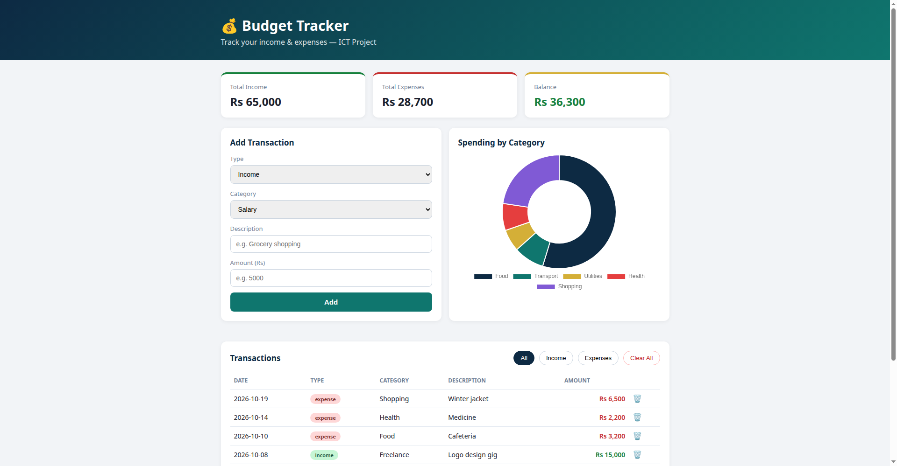

# 💰 Budget Tracker — Website

My **ICT semester project** — a fully working **budget tracker web application**.

## ✨ Features

- ➕ Add income & expense transactions (with categories)
- 💵 Live summary cards: total income, total expenses, balance
- 🍩 Doughnut chart of spending by category (Chart.js)
- 🔍 Filter transactions: All / Income / Expenses
- 🗑️ Delete individual transactions or clear all
- 💾 Data saved in the browser via **localStorage** — no backend needed
- 📱 Responsive design — works on mobile and desktop

## 📁 Project Structure

```
├── index.html   # Page structure
├── style.css    # Styling
└── app.js       # App logic, charts, localStorage
```

## ▶️ How to Run

No build step needed — just open `index.html` in any modern browser:

```bash
# or serve locally:
python3 -m http.server
# then visit http://localhost:8000
```

## 📸 Screenshot



## 🛠️ Tech

- HTML, CSS, JavaScript (vanilla)
- Chart.js for the spending chart
- localStorage for persistence

## 👩‍💻 Author

**Ayesha Shoukat** — Computer Science @ UET Narowal
